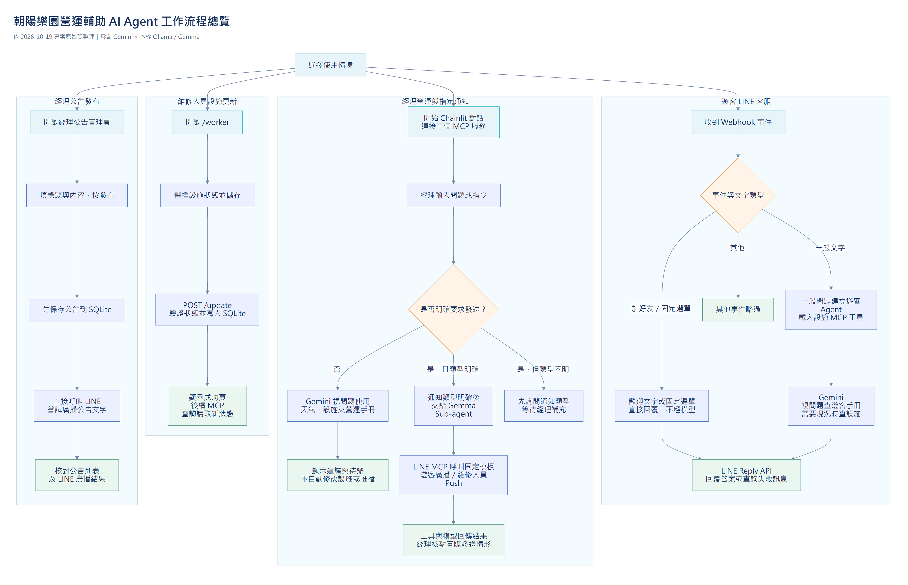

# 朝陽樂園營運輔助 AI Agent｜工作流程

更新日期：2026-10-19。依目前程式描述三端與公告流程；提示詞規範與程式實際執行的部分分別說明。

## 1. 啟動與建立對話

1. 準備 Python 環境、API 憑證及 Ollama 模型，安裝指令見 [README](README.md)。
2. 執行 `python server.py`：載入 Flask 路由與遊客檢索模組，初始化 SQLite 設施和公告資料表，提供 5000 網站入口。
3. 各自啟動設施、LINE 通知與天氣 MCP 服務。這三個服務由獨立終端機啟動，不是 Flask 自動啟動。
4. 執行 `python -m chainlit run app.py`，於 8000 開始經理對話。每段對話開始時會連接三個 MCP 服務並建立經理 Agent。
5. 經理 Agent 使用 `InMemorySaver` 與 Chainlit session 的 `thread_id` 保存該對話上下文；服務重啟或新對話不保證沿用舊記憶。

## 2. 遊客 LINE 客服

主要程式：[line_routes.py](routes/line_routes.py)、[line_qa_agent.py](ai/line_qa_agent.py)、[line_service.py](services/line_service.py)。

1. LINE 平台將事件送到 `POST /webhook`。
2. 加好友事件直接回覆歡迎文字；非文字訊息或其他不處理的事件略過。
3. 固定選單文字讀取 Flex JSON，直接呼叫 Reply API，不經 Gemini 或 RAG。
4. 一般文字問題在一對一聊天室先嘗試顯示載入動畫，再呼叫遊客 Agent。
5. 遊客 Agent 依提示詞先查遊客手冊；設施目前是否開放、暫停或維修，再使用設施 MCP。
6. Gemini 產生繁體中文簡短答案，由 Flask 使用 LINE Reply API 回覆；問答流程拋出例外時，改回覆查詢失敗文字。

| 問題類型               | 提示詞預期處理                                           |
| ---------------------- | -------------------------------------------------------- |
| 票務、交通、入園規範   | 使用遊客專用知識庫。                                     |
| 設施即時狀態           | 查遊客手冊及設施 MCP，不自行推定恢復時間。               |
| 今天是否開園／營運異動 | 無法確認時引導看公告或聯絡園方，不能以一般營業時間保證。 |
| 受傷或身體不適         | 優先聯繫現場人員或園區電話。                             |
| 無關問題               | 禮貌說明服務範圍，不編造園區答案。                       |

目前每個一般文字問題都會建立新的遊客 Agent，建立時先向設施 MCP 取得工具，因此純手冊問題也依賴該 MCP 可連線。上述檢索順序主要由提示詞引導，程式未固定強制每題呼叫工具。遊客 Agent 沒有讀取公告資料的工具，亦未配置跨題對話記憶。

## 3. 經理營運對話

主要程式：[app.py](app.py)、[agent.py](ai/agent.py)、[main_agent_prompt.py](ai/prompt/main_agent_prompt.py)。

1. 經理從 Chainlit 輸入問題。
2. 主 Agent 使用雲端 Gemini，依問題選擇資料工具。
3. 工具結果回到主 Agent，依營運手冊整理答案。
4. Chainlit 顯示串流回答，經理核對資料及現場條件後決策。

| 意圖           | 提示詞指定的資料與回覆                                                                             |
| -------------- | -------------------------------------------------------------------------------------------------- |
| 現在的天氣     | 天氣 MCP；分開呈現觀測與預報。                                                                     |
| 設施現況       | 設施 MCP；只回報目前狀態。                                                                         |
| 規章／假設情境 | 營運手冊 RAG；不套用當前天氣。                                                                     |
| 當前營運建議   | 天氣、設施與營運手冊；整理天氣、設施現況、營運結論、設施調整、現場措施、經理待辦、通知建議七部分。 |
| 未來七日規劃   | 天氣預報、紫外線與手冊第八章；用於人員、活動及備貨規劃，不直接決定當下停駛。                       |
| 指定發送通知   | 通知類型明確且經理要求發送後，呼叫通知 Sub-agent。                                                 |

營運結論以天候與手冊規則為依據，既有維修或暫停狀態另列。Agent 的建議不會直接更新資料庫，天候改善後也仍需現場檢查與經理核准才可復運。

## 4. 經理指定 LINE 通知

主要程式：[sub.py](ai/sub.py)、[line_notify.py](mcp_servers/line_notify.py)、[line_notification_types.py](line_notification_types.py)。

1. 經理明確提出發送要求，並確認通知類型。
2. 主 Agent 呼叫 `send_line_message(notification_type)`；每次工具呼叫接受一種正式通知名稱。
3. 工具將指令交給本機 Ollama／Gemma Sub-agent。
4. Sub-agent 依提示詞選擇對應 MCP 工具，讀取固定 Flex 模板並呼叫 LINE API。
5. 工具及模型回傳執行結果，經理核對 LINE 是否收到。

| 通知                         | MCP 工具                 | LINE API 與對象                  |
| ---------------------------- | ------------------------ | -------------------------------- |
| 晴天、雨天、大雨、強風、颱風 | `push_weather_message`   | Broadcast，遊客頻道的好友。      |
| 促銷                         | `push_promotion_message` | Broadcast，遊客頻道的好友。      |
| 維修                         | `push_worker_message`    | Push，維修頻道中的指定維修人員。 |

同一指令要求兩種通知時，主提示詞要求每種各呼叫一次；這不是把通知陣列塞進單一參數。每次 Sub-agent 請求「最多發送一次」屬提示詞規範，不是程式中的發送次數鎖。

## 5. 維修人員更新設施

主要程式：[facility_routes.py](routes/facility_routes.py)、[facility_db.py](db/facility_db.py)、[get_facility_status.py](mcp_servers/get_facility_status.py)。

1. 開啟 [設施管理](http://127.0.0.1:5000/worker)，讀取設施清單。
2. 選擇正常開放、暫停開放或設施維修中。
3. 表單送往 `POST /update`，驗證狀態後更新 SQLite。
4. 成功後導向 `/success`；儲存不會自動通知遊客或經理。
5. 設施 MCP 下次查詢讀取新狀態，供兩端後續問答使用，不會自動刷新已經回答的內容。

## 6. 經理發布與刪除公告

主要程式：[announcement_routes.py](routes/announcement_routes.py)、[announcement_db.py](db/announcement_db.py)、[line_service.py](services/line_service.py)。

1. 開啟 [公告管理](http://127.0.0.1:5000/admin/announcements)，填寫標題與內容。
2. 伺服器驗證內容，帶入臺北時區發布時間及發布人，先保存到 SQLite。
3. 直接呼叫 LINE Broadcast API，嘗試廣播公告文字；不經模型或通知 MCP。
4. LINE 返回 HTTP 結果後，頁面顯示成功或廣播失敗；公告可在 [公告列表](http://127.0.0.1:5000/announcements)查閱。
5. 若請求途中發生網路例外，因公告已先保存，應先查公告與 LINE 結果，避免重新發布造成重複。
6. 管理頁可刪除公告，目前沒有編輯功能；刪除不會撤回已發出的 LINE 訊息。

## 7. 三種資料與四種操作的區別

| 項目           | 現行行為                                                                 |
| -------------- | ------------------------------------------------------------------------ |
| 遊客與營運知識 | 使用分開的手冊與檢索工具，向量模型同為 BGE；不把內部手冊交給遊客 Agent。 |
| 天氣觀測與預報 | 觀測支援當下判斷；預報用於規劃，不能當作園區當下實測或開園保證。         |
| 設施與公告     | 都存入 SQLite；只有設施狀態有 MCP 查詢工具。                             |
| 營運建議       | 產生建議，不直接改設施或發送通知。                                       |
| 設施更新       | 寫入狀態，不會自動推播。                                                 |
| 聊天指定通知   | 經主 Agent、Gemma Sub-agent 與 LINE MCP 發固定模板。                     |
| 公告發布       | 保存後直接嘗試 LINE 文字廣播，不等待聊天另行指定。                       |

圖與文字經原始碼核對；外部 API、模型回覆及 LINE 實際送達需在可用環境另行驗收。
